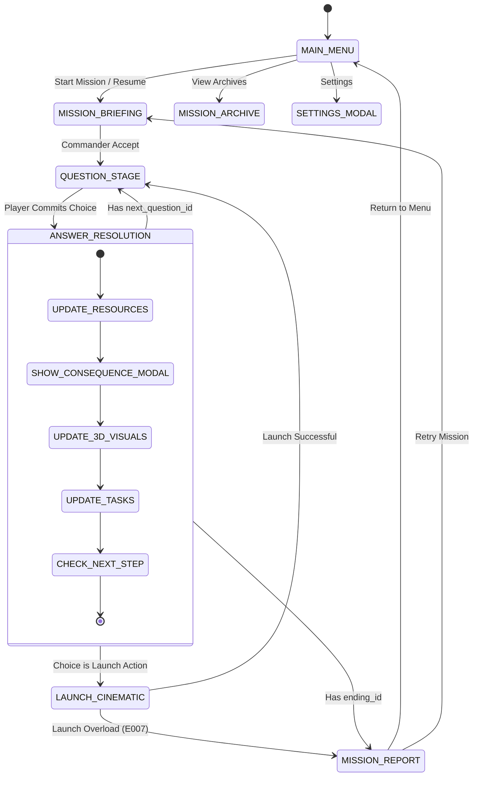

# NovaScript: Gameplay Flow & State Machine Specification

## 1. High-Level State Machine

The NovaScript runtime operates as a deterministic finite-state machine (FSM). The state machine coordinates UI views, 3D simulation scenes, audio soundscapes, and resource accounting.

---

## 2. Comprehensive Gameplay Stages

The 31 questions in `ques-en.json` span 8 core mission stages. Each stage maps to a specialized visual environment:

### Stage 1: `mission_planning` (Questions Q001 – Q003)
- **Environment**: Global Mission Control Briefing Room.
- **Visuals**: Planetary holograms of Earth, Moon, and Mars; orbital distance readouts.
- **Player Actions**:
  - Q001: Select destination (Moon: 384,400 km vs Mars: 225,000,000 km).
  - Q002 (Moon branch): Select objective (Sunlit mapping plains vs Polar crater water ice).
  - Q003 (Mars branch): Select objective (Martian atmosphere & dust storms vs Rocky crust & ancient water).

### Stage 2: `spacecraft_design` (Questions Q004 – Q007, Q013 – Q014)
- **Environment**: Spacecraft Cleanroom & Assembly Hangar.
- **Visuals**: Real-time 3D spacecraft bus with mounting rails, solar panels, MLI gold thermal blankets, radiator panels, and entry heat shields.
- **Player Actions**:
  - Bus structural sizing and primary power system (Solar array vs Dual battery bus).
  - Thermal control subsystems (Gold multi-layer insulation vs Electric heating grids).
  - Atmospheric entry architecture (Ceramic heat tiles vs Carbon-composite ablative shields).
  - Mars surface architecture (Solar rover vs Radioisotope Thermoelectric Generator / RTG).

### Stage 3: `scientific_instruments` (Questions Q008 – Q012, Q015)
- **Environment**: Payload Integration Laboratory.
- **Visuals**: Equipment inspection bench, optical sensor apertures, spectrometer booms, and radar antennae.
- **Player Actions**:
  - Optical & mapping payloads (3D high-resolution stereo cameras vs Laser mineral spectrometers).
  - Penetrating instruments (Subsurface radar sounders vs Epithermal neutron spectrometers).
  - Instrument mass vs power budget trade-off analysis.

### Stage 4: `orbit_selection` (Questions Q016, Q019, Q024)
- **Environment**: Astrodynamics Flight Dynamics Console.
- **Visuals**: Target planetary sphere with 3D orbital trajectory spline, sunlight/umbra cones, ground track coverage, and communication line-of-sight arcs.
- **Player Actions**:
  - Orbit altitude and inclination trade (Low circular polar orbit vs High elliptical frozen orbit).
  - Sun-synchronous coverage vs eclipse duration management.

### Stage 5: `launch_planning` (Questions Q021, Q022, Q025, Q027)
- **Environment**: Launch Complex & Pad Gantry.
- **Visuals**: Launch vehicle on pad, propellant loading vapor vents, payload fairing integration, and pre-launch telemetry checklist.
- **Player Actions**:
  - Selecting launch vehicle class (Small commercial budget rocket vs Medium-lift vs Proven heavy-lift vs Super-heavy).
  - Verifying payload mass margin vs rocket lift capacity to avoid payload mass overload (Ending E007).

### Stage 6: `resource_management` (Question Q018)
- **Environment**: Surface Operations Command Center.
- **Visuals**: Lunar surface terrain, hopper thruster plume, propellant tank levels, battery state of charge (SoC).
- **Player Actions**:
  - Balance science hops vs fuel reserves to avoid stranding (Ending E006).

### Stage 7: `space_communications` (Questions Q017, Q020, Q023, Q029)
- **Environment**: Deep Space Network (DSN) Telecommunications Console.
- **Visuals**: High-gain parabolic dish articulation, RF signal wave visualization connecting spacecraft to Earth ground stations (Goldstone, Madrid, Canberra), bit-rate gauges.
- **Player Actions**:
  - Managing data storage and transmission protocols (High-power live DSN downlink vs Onboard memory buffering and prioritized packet bursts).

### Stage 8: `mission_operations` (Questions Q026, Q028, Q030, Q031)
- **Environment**: In-Flight Emergency Operations Room.
- **Visuals**: Dynamic warning sirens, solar flare particle flux, Martian regional dust storm atmospheric opacity, lunar umbra eclipse entry.
- **Player Actions**:
  - Responding to mission-critical events:
    - Q026: Mars aerobraking pacing (Gradual 3-month passes vs Fast 3-week passes).
    - Q028: Mars rover dust storm survival (Low-power hibernation vs Driving in storm).
    - Q030: Solar proton storm response (Safe Mode camera shutdown vs Radiation sensor active logging).
    - Q031: Lunar eclipse power crisis (Instrument sleep mode vs Running full power in shadow).

---

## 3. Mission Consequence & Learning Feedback Loop

Whenever the player commits a decision:
1. **Audio Feedback**: Context-specific selection sound fires.
2. **Resource Mutation**: Resource deltas are applied with bound clamping [0, 100]. Animated HUD counters tick up/down with color-coded badges (`+15 Green`, `-10 Red`).
3. **Consequence Dialog**: Displays the narrative outcome (`consequence_summary`) and the NASA scientific takeaway (`learning_point`).
4. **Visual & 3D Evolution**: Installed components (solar wings, antennas, cameras, heat shields) snap onto the spacecraft model; orbital lines change color or geometry.
5. **Branch Evaluation**:
   - If `next_question_id != null`: Transitions smoothly to the next question.
   - If `ending_id != null`: Triggers final mission cinematic transition and opens the Mission Report dossier.
