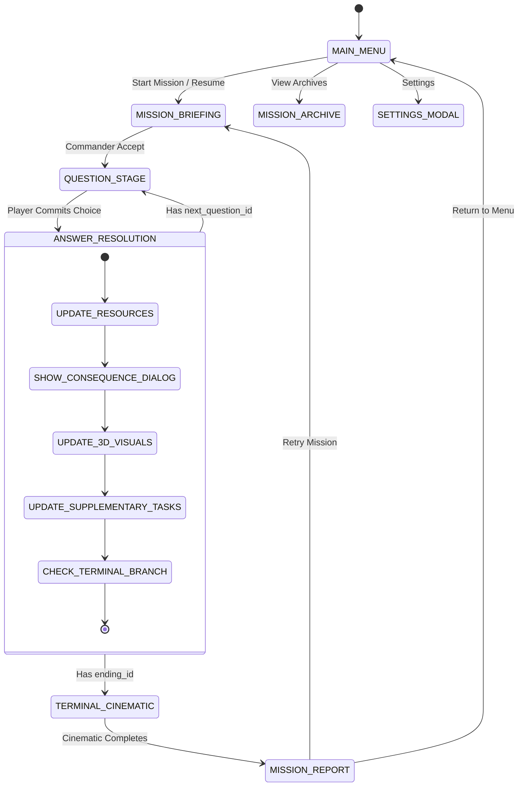

# NovaScript: Gameplay Flow & State Machine Specification

> **Specification Version**: `2.3.0 (Latest Production Release)`  
> **Status**: Production Deployed | **Architecture**: Next.js 15 App Router | **Engine**: Deterministic Pure TS  
> **Repository**: [https://github.com/mohamedkhaledcs/nova-script](https://github.com/mohamedkhaledcs/nova-script)

## 1. High-Level State Machine & Architecture

The NovaScript runtime operates as a deterministic finite-state machine (FSM). The state machine coordinates UI views, 3D simulation scenes, audio cues, and resource accounting.

> [!IMPORTANT]
> **Data Stages vs. Experience Layers**:
> The canonical game data in `ques-en.json` consists of **8 data stages** forming a directed acyclic graph (DAG) with **33 distinct playable paths** varying from 4 to 6 decisions. The **12 experience phases** described in the brief represent dynamic presentation layers and interactive environments, **not** a mandatory 12-step linear sequence.
>
> If a player chooses an option leading to an early ending (such as `E008` at `Q013` during spacecraft design or `E007` at `Q021`/`Q025` during launch planning), the mission engine immediately executes the matching cinematic sequence and displays the final mission report. It does not force the player through subsequent stages.

---

## 2. Canonical Data Stages & Question Mapping

The 31 questions in `ques-en.json` span 8 canonical data stages:

### Stage 1: `mission_planning` (Questions Q001 – Q003)
- **Environment**: Global Mission Control Briefing Room.
- **Visuals**: Planetary 3D spheres of Earth, Moon, and Mars; orbital distance indicators.
- **Player Decisions**:
  - `Q001`: Destination trade (Moon: close, saves budget, strong radio vs Mars: distant, higher budget and mass, high science).
  - `Q002` (Moon): Primary goal (Sunlit plains mapping vs Polar dark crater water ice).
  - `Q003` (Mars): Primary goal (Atmosphere & global dust storms vs Rocky crust & ancient water history).

### Stage 2: `spacecraft_design` (Questions Q004 – Q007, Q013 – Q014)
- **Environment**: Spacecraft Assembly Cleanroom.
- **Visuals**: 3D spacecraft bus with mounting rails, modular solar panels, gold MLI blankets, and heat shield surfaces.
- **Player Decisions**:
  - `Q004`: Bus & power architecture (Lightweight solar-panel bus vs Dual high-capacity batteries).
  - `Q005`: Thermal protection for lunar polar cold (Gold MLI blankets and heaters vs Heavy-duty quick-dive battery pack).
  - `Q006`: Mars orbiter architecture (Wide high-efficiency solar wings vs Streamlined aerobraking frame).
  - `Q007`: Mars surface architecture (Six-wheeled rover with robotic arm vs Geological survey orbiter).
  - `Q013`: Aerobraking thermal protection (Ceramic-composite heat tiles leading to `Q026` vs Skipping extra heat shielding with thin aluminum foil, leading immediately to `E008`).
  - `Q014`: Mars rover power source (Nuclear RTG leading to `Q027` vs Solar panels with dust wipers leading to `Q028`).

### Stage 3: `scientific_instruments` (Questions Q008 – Q012, Q015)
- **Environment**: Payload Integration Lab.
- **Visuals**: Equipment inspection bench, optical apertures, spectrometer booms, and radar antennae.
- **Player Decisions**:
  - `Q008`: Lunar surface payload (Lightweight 3D stereo camera vs High-power laser mineral spectrometer).
  - `Q009`: Battery capacity usage (Lunar hopper module vs Dual wide-angle & thermal cameras).
  - `Q010`: Lunar ice detector (Neutron spectrometer vs Heavy surface drill and heating oven).
  - `Q011`: Dark crater sensor (Laser altimeter vs Deep-penetrating ice radar sounder).
  - `Q012`: Mars atmospheric payload (Neutral gas mass spectrometer vs High-power dust/cloud lidar).
  - `Q015`: Mars geological payload (Subsurface ground-penetrating radar vs X-ray mineral spectrometer).

### Stage 4: `orbit_selection` (Questions Q016, Q019, Q024)
- **Environment**: Astrodynamics Flight Dynamics Console.
- **Visuals**: Target planetary sphere with 3D orbit spline, sunlight/shadow cones, and line-of-sight arcs.
- **Player Decisions**:
  - `Q016`: Lunar orbit profile (Low circular polar mapping orbit leading to `Q031` vs Stable medium-altitude frozen orbit leading to `E002`).
  - `Q019`: Lunar orbital inclination (High-inclination polar orbit leading to `E001` vs Low-inclination equatorial orbit leading to `E002`).
  - `Q024`: Mars orbit profile (Low upper-atmosphere sampling orbit leading to `Q030` vs High stable orbit leading to `E002`).

### Stage 5: `launch_planning` (Questions Q021, Q022, Q025, Q027)
- **Environment**: Launch Complex Console.
- **Visuals**: Launch vehicle on pad, propellant vapor venting, and pre-launch payload checklist.
- **Player Decisions**:
  - `Q021`: Lunar lander launch vehicle (Medium-lift budget rocket leading to payload overload `E007` vs Heavy-lift rocket leading to `E003`).
  - `Q022`: Laser altimeter launch vehicle (Shared rideshare leading to `E002` vs Dedicated medium rocket leading to `E003`).
  - `Q025`: Mars orbiter launch vehicle (Medium Earth-orbit class rocket leading to payload overload `E007` vs Heavy deep-space vehicle leading to `E001`).
  - `Q027`: Mars rover rocket (Proven heavy-lift rocket leading to `E001` vs Oversized ultra-heavy rocket leading to `E002`).

### Stage 6: `resource_management` (Question Q018)
- **Environment**: Surface Operations Command Center.
- **Visuals**: Lunar surface terrain, hopper thruster plume, and propellant/battery gauges.
- **Player Decision**:
  - `Q018`: Lunar hopper flight commanding (Two safe hops with data uplink leading to `E003` vs Third high-risk hop leading to fuel/battery depletion `E006`).

### Stage 7: `space_communications` (Questions Q017, Q020, Q023, Q029)
- **Environment**: Deep Space Communications Console.
- **Visuals**: High-gain parabolic antenna articulation and RF pulse transmission across deep space.
- **Player Decisions**:
  - `Q017`: Lunar spectrometer transmission (Burst low-frequency antenna leading to `E004` vs Steerable high-gain dish leading to `E001`).
  - `Q020`: Polar ice data relay (Direct-to-Earth low-frequency beacon leading to `E004` vs Lunar relay satellite overhead leading to `E001`).
  - `Q023`: Radar depth dataset downlink (High-frequency Ka-band transmitter leading to `E001` vs Onboard software compression leading to `E002`).
  - `Q029`: Mars subsurface radar DSN downlink (Point 3-meter dish at DSN leading to `E001` vs Store files and transmit prioritized highlights leading to `E003`).

### Stage 8: `mission_operations` (Questions Q026, Q028, Q030, Q031)
- **Environment**: Operational Crisis Management Console.
- **Visuals**: Warning indicators, solar flare flux, dust storm opacity, and lunar shadow entry.
- **Player Decisions**:
  - `Q026`: Mars aerobraking pacing:
    - `A051`: *"Perform dozens of gentle, shallow passes over several weeks."* -> settles smoothly into science orbit (`E003`).
    - `A052`: *"Dive deep into thick air to finish aerobraking in three passes."* -> air density spikes force emergency orbit raise (`E005`).
  - `Q028`: Mars rover dust storm commanding (Low-power hibernation until winds clear leading to `E004` vs Driving and drilling at full speed leading to rapid battery drain `E005`).
  - `Q030`: Solar storm response (Safe Mode camera shutdown leading to `E002` vs Active logging with shielded radiation sensors leading to `E001`).
  - `Q031`: Lunar shadow power management (Pause cameras during eclipse passes leading to `E002` vs Full power in the dark leading to battery depletion `E006`).

---

## 3. Terminal Cinematic Sequences

When an answer targets an `ending_id`, the engine executes an appropriate **Terminal Cinematic Sequence** before transitioning to the final report:

| Ending ID | Status | Cinematic Sequence Description |
|---|---|---|
| **E001** | `outstanding_success` | **Grand Achievement Sequence**: Triumphant 3D fly-by of target planet; high-gain dish transmits high-rate data pulse to Earth; ground station telemetry streams illuminate green. |
| **E002** | `efficient_success` | **Precision Mission Sequence**: Smooth orbital insertion burn; solar panels track the Sun; balanced resource telemetry displays mission objectives cleared on budget. |
| **E003** | `scientific_discovery` | **Discovery Reveal Sequence**: Radar/spectrometer scanning beam penetrates planetary surface; scientific data visualizer maps ancient water/ice reservoirs. |
| **E004** | `partial_success` | **Degraded Telemetry Sequence**: Intermittent signal pulses; camera feeds transmit partial low-res frames; mission operations confirms partial objective recovery. |
| **E005** | `strategy_revision` | **Emergency Maneuver Sequence**: Thrust vector warning; probe fires RCS thrusters to execute an emergency orbit raise away from dangerous atmospheric friction or dust storms. |
| **E006** | `resource_failure` | **Power Blackout Sequence**: Battery meter reaches zero; warning lights blink and fade; spacecraft systems go silent in the dark shadow / surface terrain. |
| **E007** | `launch_failure` | **Launchpad Mass Scrub Sequence**: Launch vehicle engines ignite at T-0s; telemetry alarms flash structural overload; automated countdown abort shuts down engines on the pad. |
| **E008** | `engineering_failure` | **Atmospheric Burn-up Sequence**: Spacecraft hits upper atmosphere; thin foil shields overheat and tear under friction; telemetry link severs as hull temperature exceeds limits. |

Following the cinematic sequence, the **Mission Dossier Report** displays the official title, final normalized score calculated deterministically, scientific explanation, educational learning point, and complete decision chronology.
