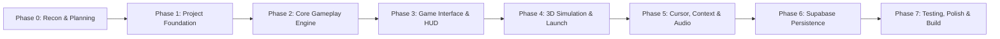

# NovaScript: Master Implementation Blueprint & Execution Plan

This document establishes the step-by-step engineering plan for NovaScript.

---

## Phase Overview & Verification Gates

---

## Detailed Phase Breakdown

### Phase 0: Reconnaissance & Planning *(Completed)*
- [x] Inspect local workspace, git status, and remote repository (`https://github.com/mohamedkhaledcs/nova-script`).
- [x] Audit `ques-en.json` (31 questions, 62 answers, 8 endings, 33 paths, 100% reachability verified).
- [x] Audit visual assets (`player.png`, `mouse cursor.png`) and NASA reference PDFs.
- [x] Author core documentation suite (`README.md`, `AGENTS.md`, 10 documents in `docs/`).
- [x] Stage source assets into `public/data/` and `public/assets/`.

---

### Phase 1: Project Foundation & Tooling
- [ ] Initialize Next.js 15+ App Router with TypeScript and Tailwind CSS 4.
- [ ] Install production dependencies:
  - Animation: `gsap`, `@gsap/react`, `motion`
  - 3D Graphics: `three`, `@types/three`, `@react-three/fiber`, `@react-three/drei`
  - Icons & UI: `lucide-react`, `clsx`, `tailwind-merge`
  - Data Validation: `zod`
  - Cloud / Backend: `@supabase/supabase-js`, `@supabase/ssr`
- [ ] Configure Tailwind theme with aerospace design tokens:
  - Deep space navy (`#070B19`), void black (`#02040A`), mission cyan (`#00F0FF`), warning amber (`#FFB020`), hazard red (`#FF3B30`), terminal green (`#00FF88`).
- [ ] Create data schema validator (`src/lib/data/game-data-schema.ts`) and typed data loader (`src/lib/data/game-data-service.ts`).
- [ ] Verify clean dev server startup (`npm run dev`) and zero build warnings.

---

### Phase 2: Core Gameplay Engine
- [ ] Implement Question Navigation Engine (`src/lib/game-engine/question-engine.ts`):
  - Traversal, history tracking, next question routing, ending detection.
- [ ] Implement Resource Management Engine (`src/lib/game-engine/resource-engine.ts`):
  - Clamping [0, 100], before/after snapshot calculation, resource delta warnings.
- [ ] Implement Safe Scoring Evaluator (`src/lib/game-engine/scoring-engine.ts`):
  - Zero-eval deterministic arithmetic parser for all 8 ending formulas.
- [ ] Implement Mission State Store (`src/lib/game-engine/mission-engine.ts`):
  - Reactive state management with complete guest LocalStorage auto-save and restore.
- [ ] Unit test all 33 paths programmatically to verify every ending triggers accurately.

---

### Phase 3: Game UI & Mission Environments
- [ ] Build **GameHUD**: Live resource gauges (Budget, Mass, Power, Science, Comms), mission timer, stage pill, and active alerts.
- [ ] Build **Phase 1: Main Menu**: Cinematic deep space backdrop, starfield, Start/Resume mission buttons, settings modal, mission archive.
- [ ] Build **Phase 2: Mission Control**: Briefing room, animated pixel-art astronaut avatar (`player.png`), mission objective acceptance.
- [ ] Build **Phase 3: Mission Planner**: Destination selector (Moon vs Mars) with interactive planetary comparison cards.
- [ ] Build **Phase 4: Spacecraft Hangar**: Bus and power system configuration interface with visual component slots.
- [ ] Build **Phase 5: Instrument Lab**: Equipment rack with interactive payload cards and learning points.
- [ ] Build **Phase 6: Orbit Planner**: Orbital altitude and trajectory selection screen.
- [ ] Build **Phase 7: Launch Prep Console**: Rocket selection, mass margin check, launch countdown checklist.
- [ ] Build **Phase 8 & 9: Mission Operations**: Event console with real-time operational alerts (dust storms, solar flare, eclipse).
- [ ] Build **Phase 10: Space Communications**: DSN signal lock console and telemetry downlink progress bar.
- [ ] Build **Phase 11: Task Board**: Dynamic objective board tracking mission milestones.
- [ ] Build **Phase 12: Mission Dossier Report**: Comprehensive ending report, official final score, decision timeline, and replay options.

---

### Phase 4: Interactive 3D & Mission Simulation
- [ ] Create Three.js Solar System scene (`SolarSystemScene.tsx`): 3D Earth, Moon, and Mars with atmospheric glows and orbit rings.
- [ ] Create Modular 3D Spacecraft scene (`SpacecraftScene.tsx`):
  - Bus chassis, dynamic solar array deployment, gold MLI blanket shader, ceramic heat shields, parabolic dish.
- [ ] Build GSAP Cinematic Launch Sequence:
  - Pad gantry, T-10 countdown, engine ignition smoke, liftoff acceleration, booster separation, payload fairing jettison.
  - Implement E007 launch scrub failure animation for overloaded rockets.
- [ ] Build Astrodynamics Orbit Scene:
  - Trajectory spline, planetary shadow/eclipse cone, real-time power drop simulation.
- [ ] Build WebGL detection & 2D blueprint fallback for non-WebGL devices.

---

### Phase 5: Rocket Cursor, Right-Click Radial Menu & Audio
- [ ] Build Custom Rocket Cursor (`CustomCursor.tsx`):
  - GPU-accelerated mouse tracking, rocket tip hotspot alignment, thrust flame click recoil, touch device suppression.
- [ ] Build Right-Click Context Menu (`ContextMenu.tsx`):
  - Viewport boundary clamping, inspect module, focus camera, mission log, touch long-press trigger.
- [ ] Build Centralized Audio Manager (`src/lib/audio/audio-manager.ts`):
  - Independent Master, SFX, and Music volume sliders with LocalStorage persistence.
  - Autoplay compliance (first-click user unlock).
- [ ] Implement Procedural Web Audio API Synthesizer:
  - Zero-asset fallback sound effects for UI blips, alarms, thrusters, radar pings, and rocket rumble.

---

### Phase 6: Supabase Persistence & Optional Accounts
- [ ] Configure Supabase client & SSR utilities (`src/lib/supabase/client.ts`).
- [ ] Create SQL migration for `profiles`, `mission_saves`, and `mission_runs` with Row Level Security.
- [ ] Add optional Login / Sign-up dialog in Mission Archive.
- [ ] Enable cloud save synchronization for authenticated players without impeding guest gameplay.

---

### Phase 7: Verification, Polish & Vercel Production Build
- [ ] Complete 33-path automated end-to-end traversal test.
- [ ] Verify score computations against the 8 official formulas.
- [ ] Test mobile and tablet responsive layouts.
- [ ] Verify keyboard accessibility (`Tab`, `Space`, `Enter`, `Escape`) and `prefers-reduced-motion`.
- [ ] Execute `npm run build` and ensure zero TypeScript errors, zero lint warnings, and clean static generation.
- [ ] Commit all code cleanly and prepare for Vercel deployment.
