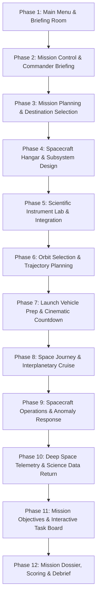

# NovaScript: Project Brief & Product Blueprint

## 1. Executive Summary

**NovaScript** is a web-based educational space mission design and flight operations simulation. Players assume the dual role of Mission Commander and Lead Systems Engineer at NASA Mission Control, making critical architectural trades, configuring spacecraft subsystems, balancing real-world engineering constraints, and operating robotic probes across the Solar System to the Moon and Mars.

Unlike static quizzes or flashcard dashboards, NovaScript delivers an immersive, interactive mission control environment with real-time 3D simulation, dynamic telemetry HUDs, custom rocket cursor interaction, contextual right-click inspection, cinematic launch sequences, and a deterministic branching game engine.

---

## 2. Product Vision & Tagline

> **Tagline**: *"Design. Decide. Explore."*

The core design philosophy is: **Every important decision has a visible, physical, and operational consequence.**

- Choosing a high-resolution spectrometer increases scientific value (+25), but adds massive electrical draw (-15 power) and payload mass (+10 kg), demanding a heavier launch vehicle or dual battery bus.
- Under-investing in power storage threatens complete mission loss during lunar eclipse night passes.
- Choosing aggressive aerobraking saves propellant but risks thermal ablation failure if heat shield tolerances are exceeded.
- Scientific discoveries are meaningless unless the spacecraft possesses sufficient communications capability (antennas, transmitter power, Deep Space Network access) to transmit data back to Earth.

---

## 3. Mission Lifecycle: 12 Phases of Exploration

NovaScript models the authentic NASA mission lifecycle through 12 distinct gameplay phases:

1. **Phase 1: Main Menu**: Deep space starfield, ambient audio, mission archive access, settings, and new mission initiation.
2. **Phase 2: Mission Control**: Mission Commander introduction with the pixel-art astronaut avatar, initial resource allocation (Budget: 70, Mass: 20, Power: 60, Science: 10, Comms: 50).
3. **Phase 3: Mission Planning**: Planetary target trade (Moon vs Mars) and core science mandate (Sunlit mapping vs Polar crater ice; Martian atmosphere vs Subsurface crust & ancient water).
4. **Phase 4: Spacecraft Hangar**: Bus sizing, power architecture (solar panels vs dual batteries vs RTG/nuclear), thermal protection (multi-layer insulation blankets vs electric heaters vs ceramic tiles).
5. **Phase 5: Instrument Lab**: Payload selection (Stereo 3D mapping cameras, Laser mineral spectrometers, Deep-penetrating radar sounders, Neutron spectrometers, Subsurface core drills).
6. **Phase 6: Orbit Selection**: Low circular polar mapping orbit vs Elliptical frozen orbit vs Direct hyperbolic atmospheric entry trajectory.
7. **Phase 7: Launch Preparation**: Payload mass verification, vehicle selection (Light commercial vs Medium-lift vs Proven heavy-lift vs Ultra-heavy), pre-launch checklist, and GSAP-orchestrated multi-stage launch sequence.
8. **Phase 8: Space Journey Simulation**: 3D solar system flight, staging, cruise phase, trajectory correction burns, and target planet approach.
9. **Phase 9: Mission Operations**: Live anomaly response (lunar eclipse shadow power drops, Martian regional dust storms, solar proton radiation storms, aerobraking velocity control).
10. **Phase 10: Deep Space Communications**: High-gain dish pointing, Deep Space Network (DSN) 70m antenna lock, bandwidth management, and data transmission to Earth.
11. **Phase 11: Mission Objectives Task Board**: Real-time progress tracker reflecting verified milestones, subsystem integrity, and telemetry health.
12. **Phase 12: Mission Report & Final Score**: Comprehensive mission review featuring the unlocked ending (1 of 8), score computation via the official ending formula, milestone log, and mission replay options.

---

## 4. Resource Economy & Engineering Semantics

| Resource | Initial Value | Bounds | Engineering Semantics | Gameplay Impact |
|---|:---:|:---:|---|---|
| **Budget** | 70 | 0 – 100 | Remaining mission financial reserve ($M). | Higher is better. Depletion prevents operations or contingency recovery. |
| **Mass** | 20 | 0 – 100 | Total spacecraft dry mass + payload (kg/scale). | **Lower is generally safer**. High mass demands heavier launch vehicles and increases launch failure risk (E007). |
| **Power** | 60 | 0 – 100 | Electrical power margin and battery energy reserves (W / % DoD). | Higher is better. Zero power causes mission-ending electrical shutdown in dark/storm passes (E006). |
| **Scientific Value** | 10 | 0 – 100 | Expected scientific return, discoveries, and data fidelity. | Higher is better. Heavily weighted in all success scoring formulas (E001, E002, E003). |
| **Communication** | 50 | 0 – 100 | RF link margin, antenna gain, and data throughput capacity. | Higher is better. Low comms prevents telemetry downlinking and science transmission. |

---

## 5. Technical & Creative Boundaries

- **Deterministic Simulation**: Educational physics visualizations are deterministic and driven by player decisions, not high-precision n-body orbital dynamics.
- **Zero Account Barrier**: Guest players can complete full missions with LocalStorage state persistence.
- **Supabase Cloud Option**: Optional cloud synchronization for mission run histories and leaderboards without interrupting guest play.
- **No Evaluation Risk**: No arbitrary code execution; all scoring formulas are evaluated via a safe AST tokenizer.
