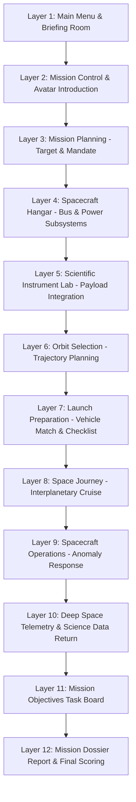

# NovaScript: Project Brief & Product Blueprint

## 1. Executive Summary & Educational Disclaimer

**NovaScript** is an educational space mission design and flight operations simulation. Players assume the role of Mission Commander at Mission Control, exploring critical architectural trade-offs, configuring spacecraft subsystems, balancing normalized engineering constraints, and operating robotic probes across the Solar System to the Moon and Mars.

> [!NOTE]
> **Independent Project Disclaimer**: NovaScript is an independent educational simulation game. It is not an official NASA product, nor is it endorsed by, affiliated with, or certified by the National Aeronautics and Space Administration or any government agency. References to NASA mission guidelines, challenges, and public literature are included solely for educational attribution.

Unlike static quizzes or flashcard dashboards, NovaScript delivers an immersive, interactive mission control environment with real-time 3D simulation, dynamic telemetry HUDs, custom rocket cursor interaction, contextual right-click inspection, cinematic launch sequences, and a deterministic branching game engine.

---

## 2. Product Vision & Tagline

> **Tagline**: *"Design. Decide. Explore."*

The core design philosophy is: **Every important decision has a visible, physical, and operational consequence.**

- Choosing a high-power instrument increases scientific value (+25 points), but significantly increases electrical draw (-15 power points) and payload mass (+10 mass points), requiring a larger bus or dual battery subsystem.
- Under-investing in power storage threatens complete mission loss during lunar shadow passes.
- Skipping thermal protection (e.g. using thin aluminum foil instead of ceramic heat tiles) causes catastrophic overheating during atmospheric entry.
- Scientific discoveries are meaningless unless the spacecraft possesses sufficient communications capability to transmit data back to Earth.

---

## 3. Experience Architecture: Presentation Layers vs. Data Stages

The player experience is structured into **12 interactive presentation layers**. These layers present rich visual and interactive environments, but they do **not** force players through a linear 12-step sequence.

The canonical game data is organized into **8 mission stages** in `ques-en.json`, yielding **33 distinct playable paths** varying from 4 to 6 decisions. Certain paths end early (e.g. thermal burn-up at Stage 2 / Question Q013, or launch scrub at Stage 5 / Question Q021 or Q025). The presentation layers adapt dynamically to the player's active flight path:

### Presentation Layers:
1. **Layer 1: Main Menu**: Deep space starfield, ambient audio settings, mission archive access, and new mission initiation.
2. **Layer 2: Mission Control**: Introduction to Mission Commander featuring the animated pixel-art astronaut avatar and initial resource briefing (Budget: 70, Mass: 20, Power: 60, Science: 10, Comms: 50).
3. **Layer 3: Mission Planning**: Destination selection (`Q001` Moon vs Mars) and core science objectives.
4. **Layer 4: Spacecraft Hangar**: Bus sizing, power architecture (solar panels vs dual batteries vs nuclear RTG), and thermal protection configuration.
5. **Layer 5: Instrument Lab**: Equipment inspection and payload selection (stereo cameras, mineral spectrometers, radar sounders, neutron spectrometers, core drills).
6. **Layer 6: Orbit Selection**: Planetary orbit altitude, inclination, and sunlight/eclipse conditions.
7. **Layer 7: Launch Preparation**: Launch vehicle selection, payload mass margin verification, and pre-launch countdown checklist.
8. **Layer 8: Space Journey Simulation**: 3D planetary cruise, booster separation, and planetary approach.
9. **Layer 9: Mission Operations**: Anomaly response console (lunar eclipse power management, Martian dust storms, solar proton flare).
10. **Layer 10: Deep Space Communications**: High-gain dish pointing, Deep Space Network (DSN) link establishment, and data downlink.
11. **Layer 11: Task Board**: Dynamic supplementary task checklist tracking mission milestones without modifying canonical graph outcomes.
12. **Layer 12: Mission Report & Final Score**: Official ending resolution (1 of 8), score calculation via official ending formula, decision history, and replay options.

---

## 4. Resource Economy & Normalized Semantics

In accordance with canonical game data, all resources are **normalized integer points on a 0 to 100 scale**, not real physical engineering units (no USD, kg, W, or %):

| Resource | Initial Value | Bounds | Normalized Game Semantics | Gameplay Impact |
|---|:---:|:---:|---|---|
| **Budget** | 70 | 0 – 100 | Remaining mission funding reserve points. | Higher is better. Depletion prevents upgrades and recovery actions. |
| **Mass** | 20 | 0 – 100 | Relative spacecraft structural and payload mass index. | **Lower is generally safer**. High mass strains launch vehicles and risks launch scrub (E007). |
| **Power** | 60 | 0 – 100 | Electrical power availability and energy storage index. | Higher is better. Depletion causes electrical shutdown during dark/storm passes (E006). |
| **Scientific Value** | 10 | 0 – 100 | Cumulative scientific discovery and observation return. | Higher is better. Primary positive contributor in success scoring formulas (E001, E002, E003). |
| **Communication** | 50 | 0 – 100 | Relative radio link margin and data throughput index. | Higher is better. Low values impair telemetry downlinks and data return. |

---

## 5. Technical & Creative Boundaries

- **Deterministic Simulation**: Visual physics and trajectories are simplified educational visualizations driven directly by player decisions, not certified n-body orbital integrators.
- **Zero Account Barrier**: Guest players can complete complete missions with LocalStorage state persistence.
- **Supabase Cloud Option**: Optional cloud synchronization for mission run histories and leaderboards without interrupting guest play.
- **No Evaluation Risk**: No arbitrary code execution; all scoring formulas are evaluated via a safe AST tokenizer.
