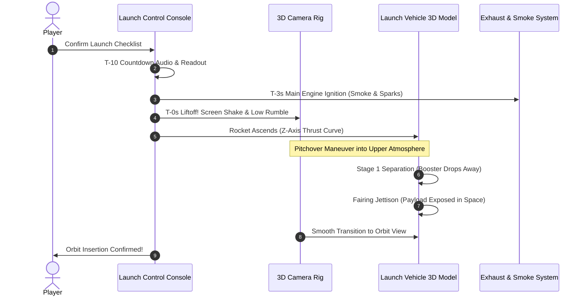

# NovaScript: 3D Simulation & Visual Mechanics Design

## 1. Simulation Philosophy & Educational Scope

NovaScript's 3D visual simulation is an **educational, deterministic visualization engine**, not a high-precision certified orbital dynamics integrator. Its primary purpose is to visually communicate the consequences of engineering decisions:

1. **Mass Index**: Expressed through spacecraft bus scale, structural reinforcement density, and booster sizing.
2. **Power Index**: Expressed through deployed solar panel surface area, internal battery glow indicators, or cylindrical RTG cooling fins.
3. **Thermal Protection**: Expressed through shimmering gold Multi-Layer Insulation (MLI), heating strips, dark ceramic-composite silica tiles, or thin aluminum foil surfaces.
4. **Communications**: Expressed through parabolic dish diameter, antenna steering articulation, and animated RF signal pulses traveling back to Earth.
5. **Orbits & Trajectories**: Expressed through glowing 3D trajectory splines, illuminated planetary hemispheres, and conical shadow (umbra) eclipse volumes.

---

## 2. Dynamic Spacecraft Model & Subsystem Adaptations

The 3D spacecraft model adapts visually to the player's recorded decisions in `ques-en.json`:

```text
              [ High-Gain Dish Antenna ] (Mounted in Q017 / Q020 / Q029)
                          |
    [ Left Solar Wing ] - [ Spacecraft Bus Core ] - [ Right Solar Wing ]
    (Small Q004 / Wide Q006)       |                (Small Q004 / Wide Q006)
                                   |
              +--------------------+--------------------+
              |                    |                    |
      [ MLI Gold Blanket ] [ Ceramic Heat Shield ] [ Thruster Assembly ]
      (Installed in Q005)  (Installed in Q013)    (Propulsion)
              |
      [ Primary Payload Bay ]
      - 3D Stereo Camera (Q008 / Q016)
      - High-Power Laser Mineral Spectrometer (Q008 / Q017)
      - Subsurface Ice Radar Sounder (Q011 / Q023 / Q029)
      - Epithermal Neutron Spectrometer (Q010 / Q020)
      - Subsurface Core Drill & Oven (Q010 / Q021)
```

### Subsystem Visual States (Verified against `ques-en.json`):
- **Spacecraft Bus & Power**:
  - `A007`: Compact bus with standard solar panels and small battery.
  - `A008`: Larger bus with dual high-capacity rechargeable battery modules glowing cyan.
  - `A011`: Extended wide high-efficiency solar wings for Mars solar illumination.
  - `A027`: Heavy-duty Radioisotope Thermoelectric Generator (RTG) with dark cooling fins.
  - `A028`: Solar-powered surface rover equipped with dust wipers.
- **Thermal Protection Subsystem**:
  - `A009`: Gold multi-layer insulation (MLI) blankets and electric heater strips on lunar bus.
  - `A025`: Tested ceramic-composite heat tiles on orbiter leading edge (safely absorbs atmospheric friction heat).
  - `A026`: **Thin aluminum foil without extra heat shielding** (saves weight, but causes catastrophic thermal failure `E008` during atmospheric entry).
- **Scientific Instruments**:
  - `A015`: Dual-lens 3D optical stereo camera aperture.
  - `A016`: High-power pulsed laser spectrometer turret with optical emitter.
  - `A019`: Neutron spectrometer detection sensor facing nadir.
  - `A020`: Heavy robotic drill rig and soil-sample heating oven.
  - `A021`: Optical laser altimeter rangefinder.
  - `A022` / `A029`: Deployable dipole subsurface radar antenna boom.

---

## 3. Cinematic Launch Sequence

Orchestrated using GSAP timelines:



- **Launchpad Mass Scrub Sequence (Ending E007)**: When an overloaded payload is paired with an underpowered rocket (Path 12 via `A041` or Path 21 via `A049`), the launchpad telemetry triggers structural mass overload warnings at T-0s, shuts down the engines, and transitions directly into the `E007` scrub report.

---

## 4. Astrodynamics & Orbit Visualization

- **Target Bodies**: Earth (departure), Moon (lunar polar orbit), Mars (areocentric orbit).
- **Orbital Spline**: 3D Catmull-Rom curve with dashed glowing trajectory lines.
- **Shadow / Eclipse Simulation**: A conical volume represents planetary umbra shadows. When the spacecraft passes behind the Moon or enters Mars shadow, solar panel power readouts drop, ambient light dims, and battery storage drain is indicated.
- **Deep Space Network (DSN) Telemetry Downlink**: When a transmission is triggered (`Q017`, `Q020`, `Q023`, `Q029`), an animated particle pulse travels from the spacecraft dish across the solar system toward Earth ground stations.
- **Graceful WebGL Fallback**: If WebGL is not supported, the viewport renders a sleek 2D high-resolution blueprint schematic displaying identical telemetry indicators.
