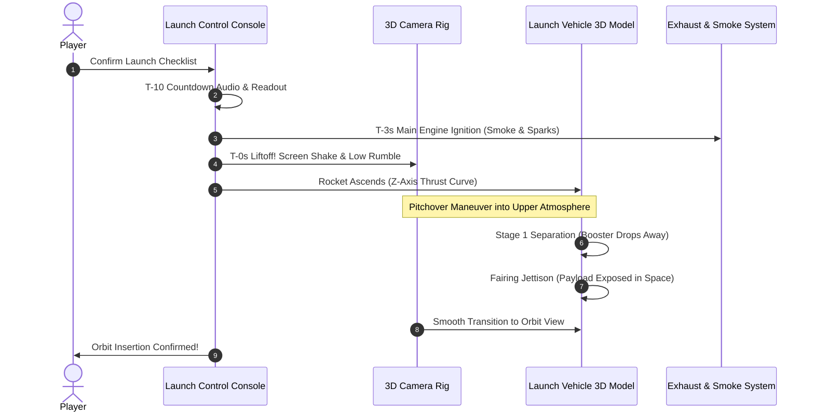

# NovaScript: 3D Simulation & Visual Mechanics Design

## 1. Simulation Philosophy

NovaScript's 3D visual simulation is an **educational, deterministic visualization engine**, not a high-precision numerical orbit integrator. Its mission is to make real engineering concepts physically visible:

1. **Mass**: Displayed via vehicle scale, structural truss density, and booster sizing.
2. **Power**: Displayed via deployed solar panel surface area, battery bay glow, or RTG nuclear cooling fins.
3. **Thermal Protection**: Displayed via shimmering gold Multi-Layer Insulation (MLI), heating elements, or dark ceramic silica tiles.
4. **Communications**: Displayed via parabolic dish diameter, articulated steering, and animated RF wave pulses traveling to Earth.
5. **Orbits & Trajectories**: Displayed via glowing elliptical trajectories, illuminated hemispheres, and umbra shadow cones.

---

## 2. Dynamic Spacecraft Model & Component Mounting

The 3D spacecraft model adapts dynamically to the player's recorded decisions:

```text
              [ High-Gain Dish Antenna ] (Mounted in Q017 / Q020 / Q029)
                          |
    [ Left Solar Wing ] - [ Spacecraft Bus Core ] - [ Right Solar Wing ]
    (Small Q004 / Wide Q006)       |                (Small Q004 / Wide Q006)
                                   |
              +--------------------+--------------------+
              |                    |                    |
      [ MLI Gold Blanket ] [ Ceramic Heat Shield ] [ Thruster Bell ]
      (Installed in Q005)  (Installed in Q013)    (Propulsion)
              |
      [ Primary Payload ]
      - 3D Stereo Camera (Q008 / Q016)
      - Laser Mineral Spectrometer (Q008 / Q017)
      - Subsurface Radar Boom (Q011 / Q023 / Q029)
      - Neutron Spectrometer (Q010 / Q020)
      - Subsurface Core Drill (Q010 / Q021)
```

### Component States:
- **Bus Body**: Standard cubic bus vs Reinforced long-duration deep-space bus.
- **Power Subsystem**:
  - `A007`: Compact single-fold solar arrays.
  - `A008`: Dual battery pack modules glowing cyan inside chassis.
  - `A011`: Extended wide triple-fold solar wings.
  - `A027`: Cylindrical RTG module with dark radiator fins.
- **Thermal Subsystem**:
  - `A009`: Gold MLI foil material with specular roughness.
  - `A025`: Dark matte black ceramic tiles on entry aeroshell.
  - `A026`: Carbon-composite ablative nosecap (triggers E008 failure burn-up).
- **Instruments**: Visual payload attachments on the instrument bay with active scanning lasers or rotating radar booms.

---

## 3. Cinematic Launch Sequence

Orchestrated using GSAP timelines:



- **Launch Failure (Ending E007)**: If the player launches an overloaded payload on an underpowered rocket (Path 12 or Path 21), the GSAP timeline decelerates after liftoff, displays structural mass alarm warnings, scrubs orbital insertion, and transitions into the E007 launch scrub report.

---

## 4. Astrodynamics & Orbit Visualization

- **Planetary Bodies**: Earth (departure), Moon (low lunar orbit), Mars (areocentric orbit).
- **Orbital Spline**: 3D Catmull-Rom curve with dashed glowing trajectory line.
- **Shadow / Eclipse Simulation**: A conical volume represents the planetary shadow. As the probe enters the shadow, solar panel power readouts drop to 0, lighting dims, and battery drain accelerates.
- **Deep Space Network (DSN) Communication**: When a transmission is commanded, an animated wave of glowing particle packets pulses from the spacecraft dish across the solar system toward Earth ground stations.
